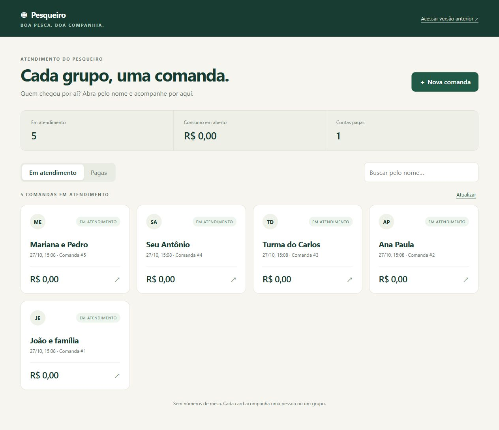

# 🎣 Projeto Pesqueiro — Comandas em Cards

Sistema de controle de consumo para pesqueiros, com comandas em cards pelo **nome da pessoa ou do grupo**, sem depender de números de mesa.

## Origem do projeto

Este é um repositório independente, adaptado do [Projeto-Pesqueiro, da organização C214-L1-202501](https://github.com/C214-L1-202501/Projeto-Pesqueiro).
Parte da estrutura e do código original foi reutilizada: API em FastAPI, persistência em SQLite com SQLAlchemy, cadastro de clientes e controle de consumo.
Os créditos dessa base pertencem aos autores e colaboradores do projeto original.

Nesta versão, a principal mudança é a interface de atendimento em cards. A tela anterior foi preservada para comparação. Este repositório não é um fork do GitHub e pode evoluir separadamente do projeto de origem.

## O que mudou

- Cards no centro da tela com nome, status e valor da comanda.
- Abertura de atendimento apenas com o nome da pessoa ou grupo, sem exigir CPF.
- Busca por nome e abas para comandas em atendimento e contas pagas.
- Abertura da comanda ao clicar no card para lançar consumo e finalizar pagamento.
- Pessoas com nomes iguais têm atendimentos separados.
- Produtos com o mesmo nome e preço aparecem agrupados, somando quantidades e valores. Os lançamentos individuais e os preços históricos são preservados.
- Link para acessar a interface anterior a qualquer momento.



## Como executar

Requisitos: Python 3.10 ou superior e Poetry.

```sh
git clone https://github.com/IgorCouto7/Projeto-Pesqueiro-Cards.git
cd Projeto-Pesqueiro-Cards
poetry install
poetry run uvicorn App.api.main:app --reload
```

Abra no navegador:

- **Versão com cards:** http://127.0.0.1:8000/cards
- **Interface anterior:** http://127.0.0.1:8000/classico
- **Documentação da API:** http://127.0.0.1:8000/docs

O banco SQLite é criado automaticamente na primeira execução. Este repositório não inclui bancos de clientes ou de testes, ambientes virtuais ou caches Python.

## Como usar

1. Clique em **Nova comanda** e informe um nome, como “João e família”.
2. Adicione os produtos, as quantidades e os preços na comanda.
3. Volte aos cards para acompanhar o atendimento e buscar outras pessoas.
4. Ao receber o pagamento, clique em **Finalizar e pagar**. A conta fica na aba **Pagas**, mantendo os registros de consumo.

## Testes

```sh
poetry run pytest
```

Para verificar a renderização do agrupamento na interface anterior, com Node.js:

```sh
node --test App/tests/comanda_frontend.test.cjs
```

Na preparação desta versão, passaram 27 testes Python e o teste da interface anterior. O fluxo de cards também foi conferido no navegador com dados fictícios.

## Detalhes das adaptações

- [Guia das duas versões](VERSAO-CARDS.md)
- [Regras do agrupamento de produtos](AGRUPAMENTO.md)

Não foi encontrada uma licença no repositório de origem nesta cópia. Este projeto preserva a atribuição aos autores originais e não atribui uma nova licença ao código reutilizado.

