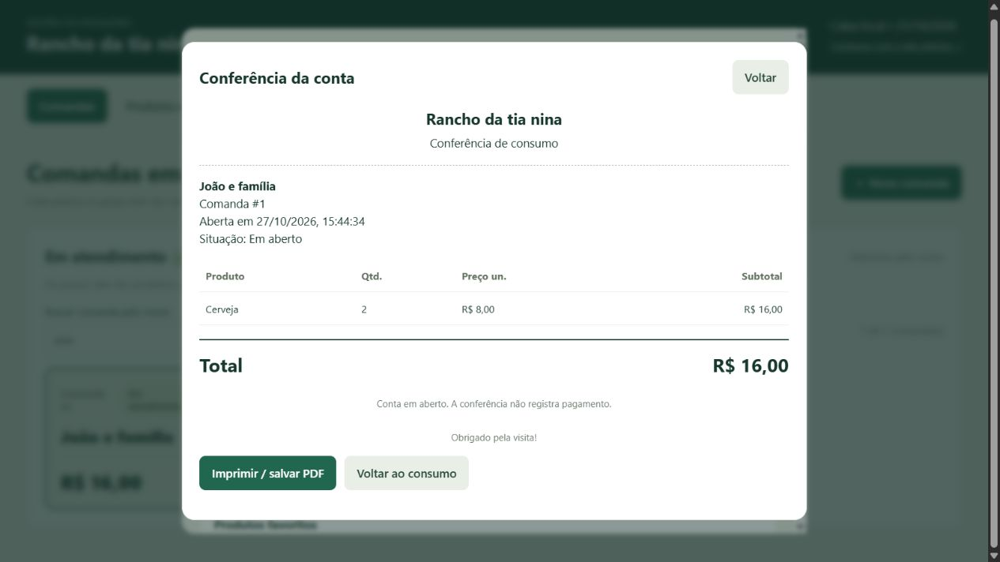

# Rancho da tia nina — versão com cards

Esta versão mantém o caixa completo do [Projeto-Pesqueiro de IgorCouto7](https://github.com/IgorCouto7/Projeto-Pesqueiro), com uma alteração visual: as comandas em atendimento aparecem em cards na área central da primeira aba.

## As três telas

1. **Comandas:** cards com nome e total no centro. Clique em um card para abrir a janela de consumo, cancelamentos, recebimento e troco. Escolha um produto cadastrado e informe a quantidade; o preço é automático.
2. **Produtos e estoque:** preservada, incluindo cadastro, preço, unidade, saldo, entrada, perda, ajuste e movimentações.
3. **Caixa e histórico:** preservada, incluindo recebimentos, fechamento, reabertura, contas pagas e backups.

Os cards usam o nome da pessoa ou do grupo. Clique em **Nova comanda** para abrir um atendimento só pelo nome, sem numerar mesas. Os preços são definidos na aba **Produtos e estoque**, não durante o lançamento.

## Agilidade no atendimento

- **Busca por nome:** filtra os cards, inclusive quando você digita sem acentos.
- **Produtos favoritos:** atalhos para selecionar um produto e informar a quantidade. Use “Escolher favoritos” para marcar os atalhos; a preferência fica salva neste navegador.
- **Consumo agrupado:** produtos iguais com o mesmo preço aparecem somados. Preços históricos diferentes continuam em linhas separadas. Os subtotais são somados como foram registrados, inclusive em vendas por peso.
- **Lançamentos individuais:** continuam disponíveis para conferir ou cancelar apenas um lançamento. Cancelamentos também permanecem no histórico.
- **Conferir / imprimir conta:** abre uma conta limpa com quantidades, preços e total, com opção de imprimir ou salvar PDF pelo navegador. Conferir ou imprimir não registra pagamento.




## Instalar e abrir no Windows

### Executável sem instalar Python

A pipeline [Testar e gerar executavel Windows](https://github.com/IgorCouto7/Projeto-Pesqueiro-Cards/actions/workflows/windows.yml) roda em cada envio para main, pull request, tag v* e também pelo botão **Run workflow**.

1. Abra **Actions** e escolha uma execução concluída com sucesso.
2. Em **Artifacts**, baixe **RanchoTiaNina-Windows-x64** (é preciso estar conectado ao GitHub).
3. Extraia o download e depois o ZIP **RanchoTiaNina-Windows-x64.zip** que está dentro dele.
4. Envie esse ZIP interno para quem vai testar. A pessoa só precisa extrair e abrir **RanchoTiaNina.exe**.

A entrega contém o executável e instruções; não inclui arquivos Python nem bancos de clientes. A janela do programa precisa ficar aberta durante o uso. O pacote é para Windows 64 bits e não é um instalador assinado.

No executável, o banco e os backups ficam em **%LOCALAPPDATA%\\RanchoTiaNina\\dados**, separados do programa. Atualizações não apagam os dados dessa pasta. Cada conta/computador tem um banco próprio. A instalação por Python continua usando a pasta dados do projeto, sem mudança de caminho. Para transferir dados entre as duas instalações, siga **LEIA-ME-WINDOWS.txt** com ambos os programas fechados.

A pipeline executa os testes Python e JavaScript, empacota com PyInstaller e abre o executável em uma pasta temporária, verificando telas, consumo e persistência após reiniciar, antes de disponibilizar o ZIP. Os downloads ficam disponíveis por 30 dias; não são publicados automaticamente em Releases.

### Instalação a partir do código

Requer Python 3.12 ou superior.

1. Execute **INSTALAR-CAIXA.cmd** uma vez.
2. Execute **INICIAR-CAIXA.cmd**.
3. Abra http://127.0.0.1:8000 ou http://127.0.0.1:8000/cards.
4. Para comparar com a lista lateral original, abra http://127.0.0.1:8000/classico.

As duas apresentações usam o mesmo banco do caixa, `dados/caixa.sqlite3`. Nenhum banco de clientes é publicado neste repositório. O banco do protótipo antigo (`pesqueiro.db`) não é convertido automaticamente.

Consulte o [guia completo do caixa](GUIA-DO-CAIXA.md).

## Desenvolvimento e testes

```sh
python -m pip install -r requirements-dev.txt
python -m pytest
node --test tests/cards.test.cjs tests/melhorias.test.cjs
python iniciar.py
```

A suíte ativa está em `tests/`. Os arquivos de `App/models`, `App/schemas` e `App/tests` são referências do protótipo antigo, como na base original. A entrada `App.api.main:app` também aponta para o caixa completo.

Os testes verificam as operações originais de estoque, preços históricos, pagamentos, cancelamentos e fechamento. Os novos testes também verificam a seleção dos cards e que o HTML das abas de estoque e caixa e a lógica das operações continuam iguais à apresentação clássica.

## Origem e versões

- Base completa: [IgorCouto7/Projeto-Pesqueiro](https://github.com/IgorCouto7/Projeto-Pesqueiro), revisão `36eed34a73a01c0078cb8b580832950c611dbd81`.
- Origem acadêmica da estrutura: [C214-L1-202501/Projeto-Pesqueiro](https://github.com/C214-L1-202501/Projeto-Pesqueiro). Créditos aos autores e colaboradores das bases reutilizadas.
- A adaptação anterior, feita sobre o protótipo simplificado, fica preservada na branch `backup/prototipo-cards`.
- A apresentação clássica completa está em `caixa-classico.html`; a apresentação com cards está em `caixa.html`.

Este é um repositório independente, não um fork do GitHub. Não foi atribuída uma nova licença ao código reutilizado.

